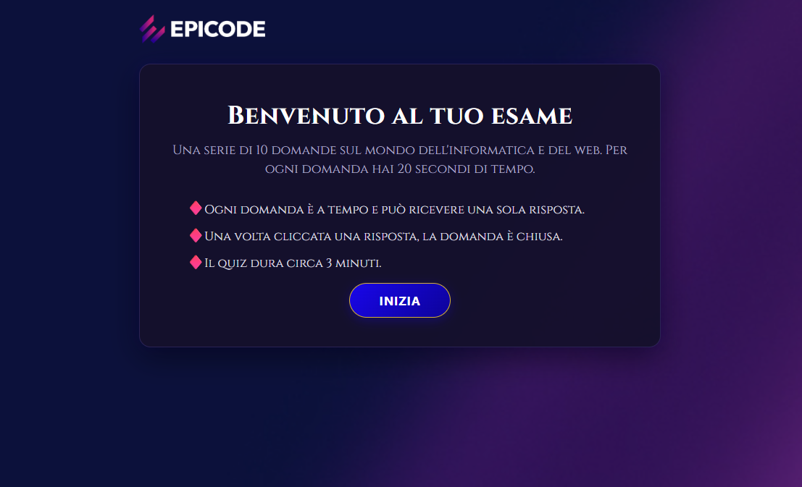
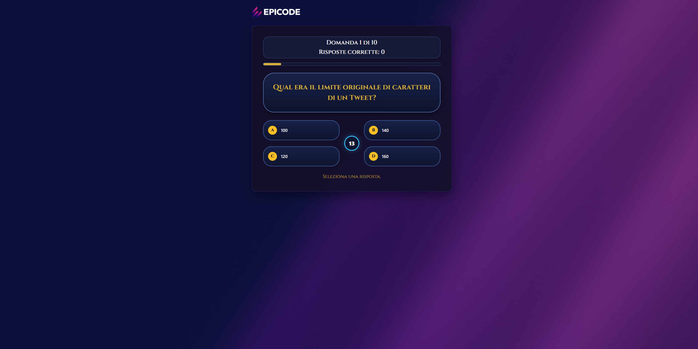
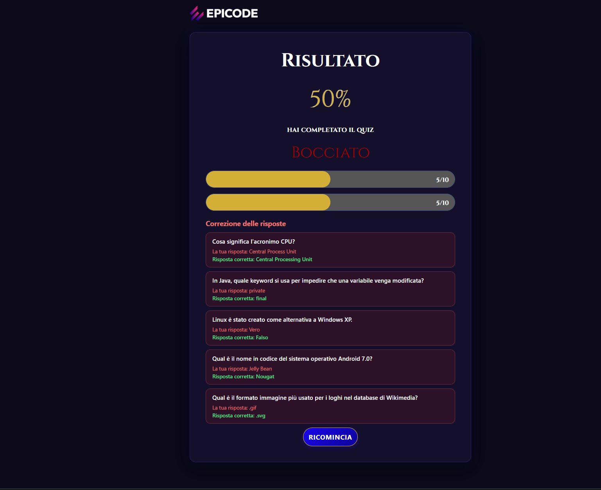

# Progetto-build-Week-1 · Quiz App

Quiz ispirato a *Chi vuol essere milionario* realizzato per la **Build Week 1**, con HTML, CSS e JavaScript.

L'interfaccia richiama un quiz televisivo, con grafica nei colori EPICODE, timer centrale, effetti visivi e accompagnamento musicale.

## Anteprima

| Welcome | Quiz | Results |
|---|---|---|
|  |  |  |

## Come Funziona

1. **Welcome:** vengono mostrati il titolo, le regole del quiz e il pulsante "Inizia", che avvia il quiz e la colonna sonora.

2. **Quiz:** 10 domande di informatica e web, ognuna con 20 secondi per rispondere. È possibile scegliere una sola risposta e, dopo il click o allo scadere del tempo, si passa automaticamente alla domanda successiva.

3. **Results:** vengono mostrati la percentuale di risposte corrette, il verdetto **Promosso** (almeno 60%) o **Bocciato**, le barre dei risultati, le correzioni delle risposte sbagliate e il pulsante "Ricomincia". Una GIF e una traccia audio differenti accompagnano ciascun verdetto.

## Funzionalità

- Tre schermate (`renderWelcome`, `renderQuiz`, `renderResults`) gestite dinamicamente nel `<main>`.
- Domande in ordine casuale, sia a 4 risposte sia Vero/Falso.
- Risposte mescolate e contrassegnate dalle lettere A, B, C, D.
- Contatore "Domanda N di 10", punteggio parziale e barra di avanzamento.
- Timer centrale di 20 secondi, con avviso rosso negli ultimi 5 secondi.
- Tempo scaduto: messaggio dedicato e passaggio automatico alla domanda successiva.
- Feedback immediato con colori e messaggi per risposte corrette e sbagliate.
- Risultato finale con percentuale, verdetto e barre riepilogative.
- Elenco a tendina delle risposte sbagliate, con risposta data e relativa correzione.
- GIF animate di Gerry Scotti differenti per promozione e bocciatura.
- Tre tracce audio: colonna sonora del quiz, musica del promosso e musica del bocciato.
- Pulsante 🔊/🔇 per attivare e disattivare l'audio.
- Possibilità di ricominciare il quiz, azzerando punteggio, errori e riproduzione audio.

## Strumenti utilizzati

- HTML5
- CSS3
- JavaScript (moduli ES6)
- GitHub
- VS Code

## Funzioni Principali

| Nome funzione | Cosa fa |
|---|---|
| `creaElemento(tag, classe, testo, id, genitore)` | Crea un elemento HTML, assegna classe, testo e ID e lo inserisce nel genitore indicato. |
| `render()` | Seleziona la schermata da visualizzare in base a `statoQuiz.currentScreen`. |
| `renderWelcome()` | Costruisce la schermata iniziale e gestisce il pulsante Inizia. |
| `renderQuiz()` | Costruisce le domande, le risposte, il timer e la barra di avanzamento. |
| `renderResults()` | Mostra il risultato, le GIF, le musiche finali e le correzioni delle risposte sbagliate. |
| `shuffleArray(array)` | Mescola casualmente gli elementi di un array. |
| `startTimer(advance)` | Avvia il timer di 20 secondi, con avviso rosso negli ultimi 5 secondi. |
| `stopTimer()` | Ferma il conto alla rovescia. |
| `handleTimeUp(advance)` | Gestisce il tempo scaduto, blocca le risposte e registra la domanda come errore. |
| `manageClick(button, answer, domanda, advance)` | Gestisce la risposta selezionata, verifica la correttezza, aggiorna il punteggio e registra eventuali errori. |
| `advance()` | Passa alla domanda successiva o alla schermata dei risultati. |

## Contributi

| Nome | Area di lavoro | Profilo GitHub |
|---|---|---|
| Emanuel Esposito | Team Leader - JavaScript - CSS | [@emanuel95esposito-ops](https://github.com/emanuel95esposito-ops) |
| Carmine Ruggiero | HTML - CSS | [@Carmine-Ruggiero](https://github.com/Carmine-Ruggiero) |
| Laura Ziino | HTML - CSS | [@nikoziino21-ai](https://github.com/nikoziino21-ai) |
| Gabriele Raggi | HTML - CSS | [@raggi370-source](https://github.com/raggi370-source) |
| Louis Anthony Pagliaro | JavaScript | [@Lokill0](https://github.com/Lokill0) |
| Matteo Fratini | GitHub - JavaScript | [@Ciabats](https://github.com/Ciabats) |

---

EPICODE · Build Week 1 · 2026
